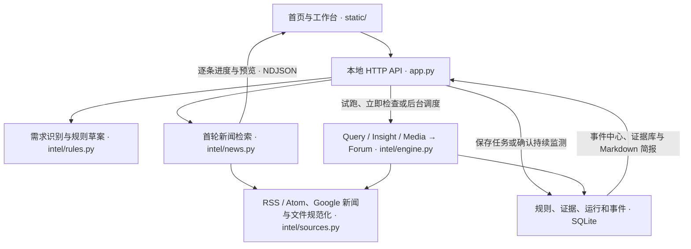

# 六扇门

六扇门是一个由用户定义任务的本地情报 Agent 工作台。用户描述要跟踪的变化，系统生成可编辑的监测规则。规则可试跑，也可启用持续检查。触发结果进入事件中心，附原始证据与处置进展。

## 启动

需要 Python 3.11 或更高版本。无需安装第三方依赖。

```sh
python3 app.py
```

在浏览器打开 http://127.0.0.1:8765 。默认加载体育赛事、游戏版本和新品口碑的合成演示。保存首个自建任务后，侧栏和事件中心会隐藏演示内容。用 `python3 app.py --empty --db data/production.sqlite3` 可在独立的空库启动。端口可用 `--port 8766` 修改。停掉服务后会停止后台检查。

RSS 解析需要 Python 发行版随附的 `pyexpat`。若系统默认 Python 无法导入该模块，可换用 `python3.11 app.py` 启动。

## 使用

首页和工作台右上角可切换「中文 / English」，浏览器会保存选择。两种语言都可提交新闻检索和监测需求。新建任务使用创建时的语言生成规则与研判说明，切换界面语言时保留已保存的名称、说明和新闻原文。

Use the **中文 / English** selector on the homepage or in the workspace. The browser remembers your choice. You can submit requests in either language. The language selected at creation determines the task's generated rules and findings. Original articles and saved task content stay in their original language.

1. 在六扇门首页的输入框描述关注对象、异常条件和需要交给谁，也可选用场景示例。发送后进入 Agent 工作台查看进度和结果。首页也可直接打开工作台或最近任务。生成的方案可展开编辑目标、关键词、数据来源、时间窗和阈值，再保存为任务。
   公开新闻类需求会实时显示正在读取的来源。每个来源返回时，工作台更新命中条数、代表标题或读取失败状态，再展示跨来源去重后的结果。可以展开「检索过程」回看。例如输入「帮我跟踪 F1 比赛的新闻」，会读取 Formula 1 官网和 Motorsport.com 的订阅。其他公开新闻主题可用 Google 新闻 RSS 搜索。点「仅看本次」即可保留预览，核对规则后点「确认并开启监测」才会建任务和定时检查。对于不提供发布时间的订阅，页面显示首次发现时间。
2. 在证据库导入 CSV / JSON，或在规则里启用已有 RSS / Atom 源。
3. 试跑规则。可以选一个历史截止时间，按记录的发布时间回放。试跑保存结果，不创建正式事件。
4. 启用规则后，后台按频率检查，也可立即检查。进入事件查看证据、建议和处置时间线。已处理事件只有在出现新证据并再次达到阈值时才会重新打开。
5. 在研判概览导出 Markdown 简报。

导入记录要求 `text` 和 `published_at`，可选 `source`、`kind`、`title`、`entity`、`reference`、`external_id` 和 `url`。时间优先使用 ISO 8601，缺少时区时按北京时间处理。 `kind` 支持 `internal`（自有资料）、`public`（公开资料）、`media`（字幕或文字稿）。同一订单或同一事件的跨渠道记录可填写同一个 `reference`，避免重复计数。

需要练习真实导入流程时，可使用 `python3 examples/sports_csv.py > sports-sample.csv` 生成一份带当前时间的合成样例，并创建关注「城南杯」入场与验票的任务。

## 项目架构 / Architecture

参考 [BettaFish](https://github.com/666ghj/BettaFish) 中采集、Query / Insight / Media 并行分析、Forum 汇总和 Report 交付的职责拆分。本项目以独立实现完成。



| 模块 / Module | 职责 / Responsibility |
| --- | --- |
| `static/index.html`、`static/app.js`、`static/styles.css` | 原生 Web 界面。管理首页、对话、任务和事件视图。 |
| `static/i18n.js`、`intel/i18n.py` | 界面文案使用浏览器语言偏好。API 读取 `Accept-Language`，任务的生成语言保存在规则 JSON 里。 |
| `app.py` | Python 标准库 HTTP 服务，负责静态资源、API、流式响应、后台调度和 Markdown 导出。 |
| `intel/rules.py`、`intel/news.py` | 把需求编译成可编辑规则，查询并去重公开新闻，保存短时预览。用户确认后创建持续监测任务。 |
| `intel/sources.py`、`intel/engine.py` | 规范化订阅和文件记录，按公开来源、内部反馈和媒体文字稿并行匹配，汇总证据并判断规则是否触发。 |
| `intel/store.py` | 用 SQLite 持久化规则版本、证据、试跑和正式运行结果、事件进展。 |

The browser UI talks to a Python standard-library HTTP service. News discovery streams source progress and a temporary preview. Confirming the preview creates a monitoring task in SQLite. Scheduled and manual checks match public, internal, and media evidence in parallel before applying the rule thresholds. The workspace reads the resulting evidence, runs, and events from SQLite.

统计使用精确关键词和规范化文本／引用编号去重。规则适用时可编辑关键词、别名和阈值。时间回放只能用已经留档的记录，无法还原未保存的数据。当 RSS 拉取失败时，运行详情会标明来源缺口，已有事件不会因不完整数据被更新。媒体分析使用文字稿，不直接处理视频和音频。

## 可选配置

`LSM_FEEDS` 接受本地管理员控制的 JSON 对象。键是短标识，值包含 `name` 和 `url`。使用可信 HTTPS RSS / Atom 地址，修改后重启服务。浏览器只能选择预先配置的数据源。

默认离线规则模式可以起草方案、确定性研判和补查。要启用可选模型，设置 `LSM_LLM_ENDPOINT`（完整的 OpenAI 兼容聊天完成地址）、`LSM_LLM_MODEL`，以及供应商要求的 `LSM_LLM_KEY` 后重启。界面可以单独勾选模型起草或本次运行的模型补充研判。后者会把有限候选证据发送给配置的模型，输出必须引用已有证据编号。模型不参与计数或改变触发结果。后台定时运行默认使用规则，只有设置 `LSM_BACKGROUND_MODEL=1` 时才会发送候选证据给已配置模型。

这是单用户本地首版，仅监听 `127.0.0.1`，数据保存在 SQLite 文件中。首版的数据入口为文件导入和配置好的订阅，暂未接入第三方平台抓取、消息发送及多用户账号。
